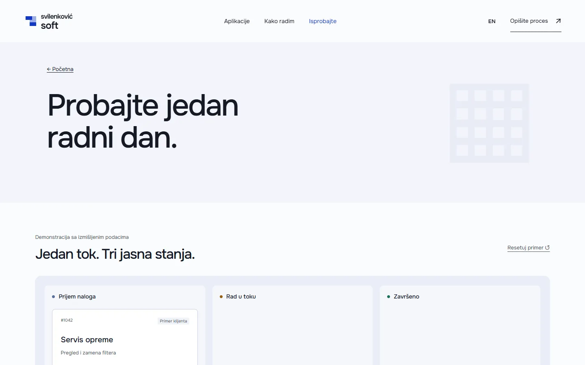

# Svilenković Soft

A business software site that follows one job from the first request to the record, with a work order demo built on made-up data.

**[svilenkovicsoft.com](https://svilenkovicsoft.com/)** · [Case study (in Serbian)](https://svilenkovic.rs/radovi/svilenkovic-soft) · [Srpski](README.sr.md)

> [!NOTE]
> My own project, not client work. The source code is private. This page describes what the site does and how it is built.

<table>
  <tr><td><b>Client</b></td><td>Own project</td></tr>
  <tr><td><b>Industry</b></td><td>Custom business applications</td></tr>
  <tr><td><b>Location</b></td><td>Serbia</td></tr>
  <tr><td><b>Type</b></td><td>Multi-page website</td></tr>
  <tr><td><b>My role</b></td><td>Research, design, development, SEO and hosting</td></tr>
  <tr><td><b>Stack</b></td><td>Astro 7, TypeScript, GSAP, PHP 8.3, SQLite, nginx</td></tr>
</table>

## About the project

An application makes sense only when it follows the order of the real work. That is why Svilenković Soft does not open with a feature list. It starts with where a request comes in, who takes the task and what stays on record when it is done.

On the home page an inquiry turns into a schedule and then into a record as the visitor scrolls. A separate demo page shows how one work order gets a status and a history, and it is clearly marked as using made-up data, so it does not stand for a real customer or a real result. Next to the screens are the questions I ask before writing code: who can see what, exports, backups and what happens when something fails.

## What I built

- A scroll scene where an inquiry becomes a scheduled task and then a record
- A work order demo with invented data, labelled as such
- A page on turning a process into an application, and a case study of the AutoSet Niš workflow and stock panel
- Content that reads as ordinary pages without scripts
- Serbian and English versions of every page

## Results

| | Performance | Accessibility | Best practices | SEO |
| :-- | :-: | :-: | :-: | :-: |
| Mobile | 100 | 100 | 100 | 100 |
| Desktop | 100 | 100 | 100 | 100 |

PageSpeed Insights, lab test of the live site, October 2026. Security headers: 6 of 6. Structured data: `Organization`, `Person`.

## Screenshots

<table>
  <tr>
    <td width="68%" valign="top"></td>
    <td width="32%" valign="top"></td>
  </tr>
</table>

Work order demo on the live site

---

Built by [D. Svilenković](https://svilenkovic.com).
