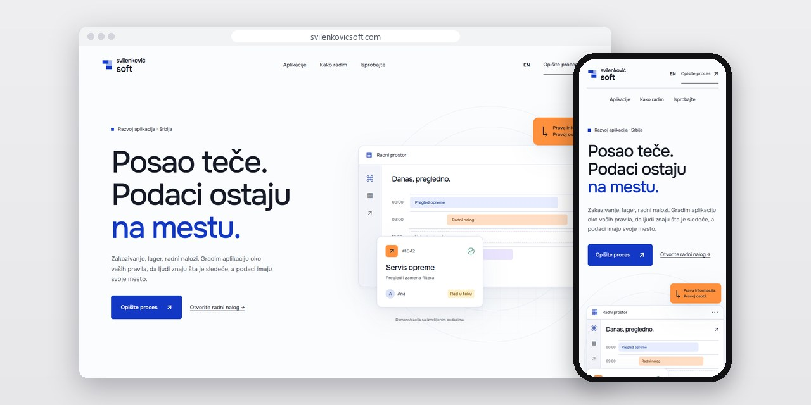
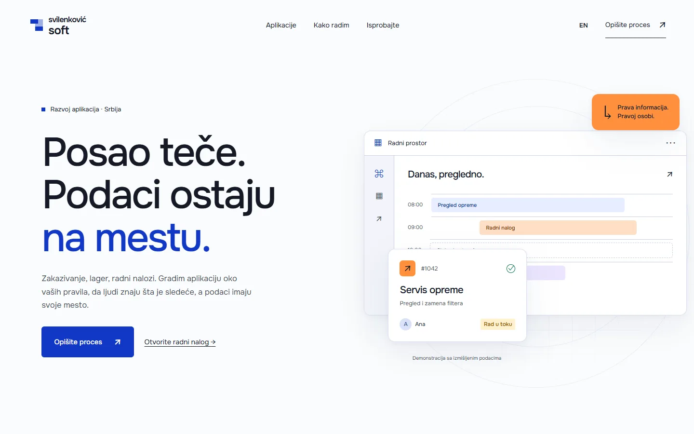
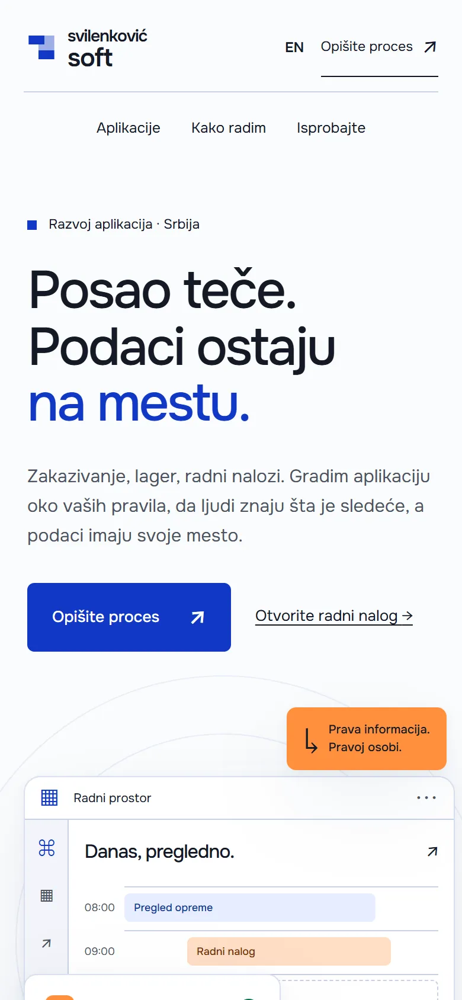
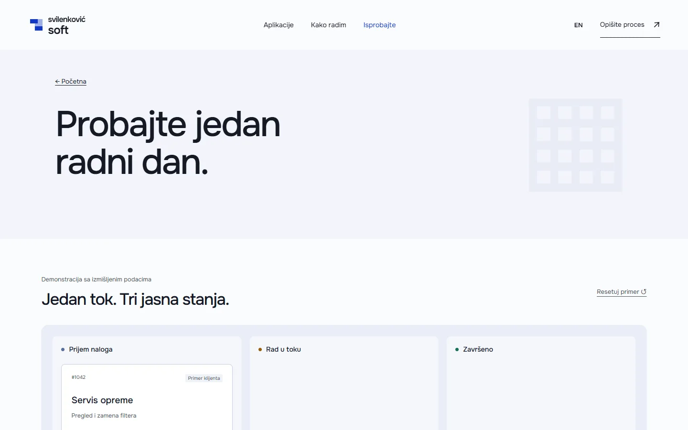

# Svilenković Soft

Sajt o poslovnim aplikacijama koji prati jedan posao od prvog upita do evidencije, uz demo radnog naloga sa izmišljenim podacima.

**[svilenkovicsoft.com](https://svilenkovicsoft.com/)** · [Studija slučaja](https://svilenkovic.rs/radovi/svilenkovic-soft) · [English](README.md)

> [!NOTE]
> Moj sopstveni projekat, ne klijentski posao. Izvorni kod je privatan. Ova stranica opisuje šta sajt radi i kako je napravljen.

<table>
  <tr><td><b>Klijent</b></td><td>Sopstveni projekat</td></tr>
  <tr><td><b>Delatnost</b></td><td>Poslovne aplikacije po meri</td></tr>
  <tr><td><b>Lokacija</b></td><td>Srbija</td></tr>
  <tr><td><b>Vrsta</b></td><td>Sajt sa više strana</td></tr>
  <tr><td><b>Moj deo posla</b></td><td>Istraživanje, dizajn, izrada, SEO i hosting</td></tr>
  <tr><td><b>Tehnologije</b></td><td>Astro 7, TypeScript, GSAP, PHP 8.3, SQLite, nginx</td></tr>
</table>

## O projektu

Aplikacija ima smisla tek kad prati redosled stvarnog posla. Zato Svilenković Soft ne počinje spiskom funkcija. Počinje pitanjem gde nastaje upit, ko preuzima zadatak i šta ostaje zabeleženo kad se posao završi.

Na naslovnoj upit prelazi u raspored, pa u evidenciju, dok posetilac skroluje. Posebna demo strana pokazuje kako jedan radni nalog dobija status i trag, i jasno je označena kao primer sa izmišljenim podacima, pa ne predstavlja stvarnog kupca ni stvaran rezultat. Pored ekrana stoje pitanja koja postavljam pre pisanja koda: ko šta vidi, izvoz, rezervne kopije i šta se dešava kad nešto ne uspe.

## Šta sam uradio

- Scena uz skrol u kojoj upit postaje zakazan zadatak, pa zapis u evidenciji
- Demo radnog naloga sa izmišljenim podacima, tako i označen
- Strana o tome kako proces postaje aplikacija i studija o radnom toku i lageru za AutoSet Niš
- Sadržaj koji se bez skripti čita kao obične strane
- Srpska i engleska verzija svake strane

## Merenja

| | Performanse | Pristupačnost | Dobre prakse | SEO |
| :-- | :-: | :-: | :-: | :-: |
| Telefon | 100 | 100 | 100 | 100 |
| Desktop | 100 | 100 | 100 | 100 |

PageSpeed Insights, laboratorijsko merenje živog sajta, oktobar 2026. Sigurnosna zaglavlja: 6 od 6. Strukturisani podaci: `Organization`, `Person`.

## Snimci ekrana

<table>
  <tr>
    <td width="68%" valign="top"></td>
    <td width="32%" valign="top"></td>
  </tr>
</table>

Demo radnog naloga na živom sajtu

---

Izrada: [D. Svilenković](https://svilenkovic.rs).
